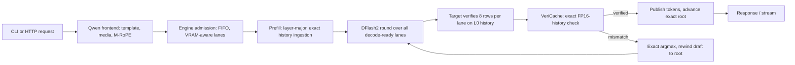

# Architecture

VoidInfer is one engine: the EXL3 coherent-device lane engine behind the public `Engine` facade.
The CLI, the HTTP server and the benchmark harness all drive it; research tools under
`tests/research_exl3_*` drive the text model directly.

## Request path

1. **Frontend** (`src/targets/qwen3_6`): chat template rendering, tool and reasoning semantics,
   media decode/resize/BF16 packing and three-axis M-RoPE prompt positions. The output session
   splits reasoning, content and tool calls.
2. **Admission** (`src/exl3/exl3_engine_core.cpp`): bounded FIFO, one to eight lanes. A lane is
   admitted only when its L0 history codes fit in free VRAM, so long agents never oversubscribe the
   device under WDDM.
3. **Prefill**: layer-major prompt ingestion with fused EXL3 weight decode, FA2-style GQA attention
   and a chunk-parallel Gated-DeltaNet recurrence. Prompts under 2,048 rows use the row-wise path.
   Prompt history is attended exactly (FP16 history).
4. **Decode**: every round batches the decode-ready lanes. The 5-layer DFlash2 draft proposes seven
   tokens per lane; one target pass verifies a verification tree (main chain plus sibling leaves,
   8 rows) per lane. Rejected rows roll back exactly (device KV transactions with checkpoint graphs,
   retained-prefix GDN repair).
5. **VeriCache**: drafted tokens are published only after an exact pass rescored them against FP16
   history streamed from host memory. With one lane the pass runs asynchronously on an exact line (a
   second context on the same planes, its own GDN state and stream). With several lanes passes are
   exclusive.
6. **Publication and reuse**: the verified prefix becomes the next exact root (device GDN checkpoint
   plus L0 rewind). A finished conversation's root keeps its plane set; a follow-up turn resumes by
   remapping that set behind the lane's window. Media prompts neither reuse nor publish roots.

## KV tiers

| Tier | Where | Contents |
|---|---|---|
| Exact window | device | 64-token sink, 960-token recent window, 1,024-row prefill chunk, ring |
| Hot rows | device | 512 rows per KV head as exact FP16 copies, refreshed from the code pass's nominations |
| L0 | device | calibrated-rotation INT4 (or `VOIDINFER_EXL3_L0_CODE_BITS=2`: INT2) history codes (`<target>/l0_oscar` rotations) |
| L2 | pinned host memory | exact FP16 planes per conversation (plane sets in growable CUDA VMM regions); packed when idle, spilled to disk under pressure |

The lane's window virtual address aliases the chunks of the plane set it serves
(`Exl3GrowableDeviceRegion::attach_window`), which is why resuming an agent is a remap, not a copy.

## Profile

The Engine applies its benchmarked kernel and route profile at core construction
(`src/exl3/engine_profile.cpp`): every listed `VOIDINFER_*` switch that the process has not set is
set to its profile value, and the startup check rejects values that leave the qualified route.
`VOIDINFER_*` variables therefore act as overrides for experiments, not as required configuration.
Strict opt-in switches share one parser (`src/exl3/environment_options.h`): absent and `0` disable,
`1` enables, anything else is an error.

## Source map

| Area | Primary locations |
| --- | --- |
| Public API and lifecycle | `include/voidinfer/engine.h`, `include/voidinfer/types.h`, `src/runtime/engine/` |
| CLI and server | `apps/cli/`, `apps/serve/`, `src/serve/` |
| Engine core, lanes, admission | `src/exl3/exl3_engine_core.*`, `src/exl3/vericache_serving_*` |
| Text model, attention, GDN, L0 OSCAR | `src/exl3/text_model.*`, `full_attention_layer.*`, `gdn_layer.*`, `l0_oscar.cuh` |
| EXL3 weights and linears | `src/exl3/safetensors.*`, `linear_cuda.*`, `src/exl3/mia_exllamav3/` |
| DFlash2 draft | `src/exl3/dflash2_*` |
| VeriCache | `src/exl3/vericache_*`, `fast_device_round.h` |
| Vision tower | `src/exl3/vision_dense.*`, `src/ops/` |
| Frontend | `src/targets/qwen3_6/`, `src/media/`, `src/product/` |
| Engine profile | `src/exl3/engine_profile.*` |
| Exact DFlash2 oracle | `tests/test_exl3_dflash2_accept.cpp` |
| Serving contracts | `src/serve/`, `tests/test_*schema*`, `tests/test_*http*` |

The principal tradeoff is explicit specialization: one model on one GPU class lets the kernels and
state ownership be exact and fast, at the price of portability.
